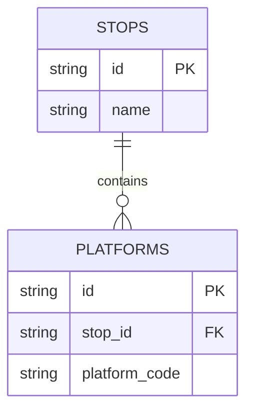
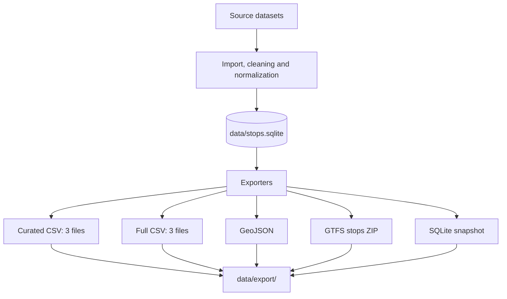

# Data exports

The [gtfs-sk/stops](https://github.com/gtfs-sk/stops) project produces a processed,
normalized dataset of public transport stops and platforms. This document describes
**what each exported file contains, how its columns are structured, and how to use it**.

All export files are generated in `data/export/` by running:

```bash
python build.py
```

> [!IMPORTANT]
> These files contain the **processed dataset**, not an unchanged copy of the ISCP
> source. A separate raw/normalized ISCP publication is not part of these exports.

## Available files

```text
data/
├── stops.sqlite                         # Working database (not an export)
└── export/
    ├── stops.csv                        # Stops only, curated columns
    ├── platforms.csv                    # Platforms only, curated columns
    ├── stops-and-platforms.csv          # Both, curated columns
    ├── stops.full.csv                   # Stops only, all mapped columns
    ├── platforms.full.csv               # Platforms only, all mapped columns
    ├── stops-and-platforms.full.csv     # Both, all mapped columns
    ├── stops.geojson                    # Geographic features
    ├── stops.gtfs.zip                   # ZIP containing stops.txt
    └── stops.sqlite                     # Complete SQLite snapshot
```

| Format | File(s) | Contents | Recommended use |
| --- | --- | --- | --- |
| Curated CSV | `stops.csv`, `platforms.csv`, `stops-and-platforms.csv` | Stable, human-oriented schemas: **12 columns for stops**, **14 for platforms and combined** | Spreadsheets, analysis, integrations |
| Full CSV | `stops.full.csv`, `platforms.full.csv`, `stops-and-platforms.full.csv` | Every mapped column of the stop and/or platform models | Detailed analysis, auditing and data migration |
| GeoJSON | `stops.geojson` | Geographic features representing stops and platforms | GIS software, maps |
| GTFS | `stops.gtfs.zip` | A GTFS `stops.txt` table | GTFS-related tools and integrations |
| SQLite | `stops.sqlite` | A snapshot of the **entire working database** | SQL queries and complete relational data access |

**Which file should I choose?** Use `stops.csv` when you want a list of stops,
`platforms.csv` when you want boarding locations, or `stops-and-platforms.csv`
when you want both as one table. Choose a `*.full.csv` variant for original
model columns. Choose SQLite if you need **all database tables and relationships**.

## Data model and identifiers

A **stop** represents a stop or station record. A **platform** is a separate
record associated with a stop. A stop can have zero or more platforms.



This diagram shows the relevant *logical relationship*, not the complete SQL
schema. The name of the foreign-key field depends on the export format:

| Context | Stop identifier | Platform identifier | Parent-stop reference |
| --- | --- | --- | --- |
| Curated CSV | `id` | `id` | `platform_parent_id` |
| Full CSV | Model's `id` | Model's `id` | Typically `stop_id` (the mapped model column) |
| SQLite | `stops.id` | `platforms.id` | `platforms.stop_id` |
| GTFS `stops.txt` | `stop_id` | `stop_id` | `parent_station`, where applicable |

> [!NOTE]
> `platform_parent_id` references the project's **internal `id` of the stop**;
> it is **not** an ISCP ID. `parent_station` is the standard GTFS field name
> and is not a replacement for `platform_parent_id` in the CSV schema.

The three curated CSV files are different **views of the same records**, not
three independent datasets. The same applies to the three full CSV variants.
Do not concatenate all six CSVs and treat the result as six distinct sets of
stops or platforms.

## Curated CSV: fixed, record-specific schemas

**Files:** `stops.csv`, `platforms.csv`, `stops-and-platforms.csv`

The stop-only file omits the two platform-specific fields. The platform-only
and combined files retain both fields so platforms can be linked back to stops.
The first twelve columns use the same names and order in all three files.

**`stops.csv` — 12 columns:**

```csv
id,iscp_id,name,type,lat,lon,country,region,district,municipality,modes,amenities
```

**`platforms.csv` and `stops-and-platforms.csv` — 14 columns:**

```csv
id,iscp_id,name,type,lat,lon,country,region,district,municipality,modes,amenities,platform_code,platform_parent_id
```

### Column reference

| Column | Data / representation | Description | Stops | Platforms |
| --- | --- | --- | --- | --- |
| `id` | Identifier (text) | Unique identifier of this stop or platform record. Use this for joins inside the dataset. | Stop ID | Platform ID |
| `iscp_id` | Source identifier (text, optional) | ISCP identifier associated with the record, if one is available. It is distinct from `id`. | Where known | Where known |
| `name` | Text | Display name of the stop or platform. | Yes | Yes |
| `type` | Text | Record classification. Stop rows use the stop model's kind; platform rows use `platform`. | Stop kind | `platform` |
| `lat` | Decimal degrees, optional | Latitude of the record's geographic position. | Stop position | Platform position |
| `lon` | Decimal degrees, optional | Longitude of the record's geographic position. | Stop position | Platform position |
| `country` | Text, optional | Country associated with the record (for example, `SK`). | Where known | Where known |
| `region` | Text, optional | Administrative region. | Where known | Where known |
| `district` | Text, optional | Administrative district. | Where known | Where known |
| `municipality` | Text, optional | Municipality. | Where known | Where known |
| `modes` | Serialized multi-value field | Available transport modes, using the existing curated CSV serialization. | Stop modes | Platform modes |
| `amenities` | Serialized multi-value field | Amenities/accessibility attributes, using the existing curated CSV serialization. | Stop amenities | Platform amenities |
| `platform_code` | Text, optional | Platform number/code as represented by the source data. | Not included in `stops.csv`; empty for stop rows in the combined file | Where known |
| `platform_parent_id` | Identifier (text), optional | ID of the stop to which the platform belongs; references a row in `stops.csv`. | Not included in `stops.csv`; empty for stop rows in the combined file | Parent stop ID |

The `modes` and `amenities` fields can contain multiple values. Their
representation is inherited from the existing `CsvExporter` implementation;
**do not assume they are separate CSV columns**. When importing, preserve the
complete cell value unless your application explicitly parses that format.

An empty CSV cell indicates no value was emitted for that field. It does not
necessarily mean the concept is absent (for example, an empty `amenities` cell
is not proof that a location has no amenities).

### Row selection

| File | Included rows | Excluded rows | Key relationship |
| --- | --- | --- | --- |
| `stops.csv` | One row per stop | All platform records | `id` is the stop ID; no platform-only columns |
| `platforms.csv` | One row per platform | All stop records | `platform_parent_id` → `stops.csv.id` |
| `stops-and-platforms.csv` | Every stop **and** its platforms | Nothing from those two record types | `type` distinguishes rows; platform rows contain `platform_parent_id` |

A stop without platforms still appears in `stops.csv` and
`stops-and-platforms.csv`; it does not create an artificial platform row.

For example, to associate each platform with its stop in Python:

```python
import csv

with open("data/export/stops.csv", encoding="utf-8", newline="") as f:
    stops = {row["id"]: row for row in csv.DictReader(f)}

with open("data/export/platforms.csv", encoding="utf-8", newline="") as f:
    for platform in csv.DictReader(f):
        stop = stops.get(platform["platform_parent_id"])
        print(platform["name"], "→", stop["name"] if stop else "unknown stop")
```

## Full CSV: dynamically derived model columns

**Files:** `stops.full.csv`, `platforms.full.csv`,
`stops-and-platforms.full.csv`

Unlike the curated exports, **the full CSV headers are not hardcoded**. They
are obtained at export time from the mapped SQLAlchemy attributes of the
`Stop` and `Platform` models. This means a newly mapped database column will
appear in the appropriate file without modifying the full CSV exporter.

### Exact header construction

| File | Rows | Header columns, in order |
| --- | --- | --- |
| `stops.full.csv` | Stops | `inspect(Stop).column_attrs.keys()` |
| `platforms.full.csv` | Platforms | `inspect(Platform).column_attrs.keys()` |
| `stops-and-platforms.full.csv` | Stops and platforms | `record_type`, followed by **all stop columns**, then **platform columns not already present**, preserving their model order |

The combined file adds one column not necessarily present in either model:

| Column | Possible values | Meaning |
| --- | --- | --- |
| `record_type` | `stop`, `platform` | Identifies which model the row comes from. This is **not** the same as the curated CSV's `type` field or the stop model's `kind`. |

### Important model fields

These are examples of mapped fields used by the export implementation and
tests; **they are not a complete or permanently fixed full-CSV header**.
The authoritative column list is the currently installed model schema.

| Column | Model / where applicable | Meaning |
| --- | --- | --- |
| `id` | Both models | Record identifier. In the combined file it identifies the row's stop **or** platform. |
| `name` | Both models | Record name. |
| `source` | Where mapped | Source system associated with the record. |
| `original_id` | Where mapped | Identifier from the source system; not necessarily the same as `iscp_id`. |
| `kind` | Stop model, where mapped | Stop/station classification in the database model. |
| `stop_id` | Platform model, where mapped | Foreign key referencing the parent stop. This is the database-oriented counterpart of the curated `platform_parent_id`. |
| `platform_code` | Platform model, where mapped | Platform number/code. |
| `lat`, `lon` | Where mapped | Geographic coordinates. |
| `modes`, `amenities` | Where mapped | Model-level multi-value attributes. |

For example, a field added later to `Platform` automatically becomes a column
in both `platforms.full.csv` and `stops-and-platforms.full.csv`. It does **not**
become a column in `stops.full.csv` unless the `Stop` model also maps it.

When a merged column is not defined for the row's model (for example, a
platform-only attribute on a stop row), the corresponding CSV cell is empty.
The combined export does **not** prefix overlapping model field names; if both
models define `name`, that is one shared CSV column.

### Value serialization

| Python / model value | Written to full CSV |
| --- | --- |
| `None` / SQL `NULL` | Empty cell |
| `Enum` | Its `.value` |
| Date, time, datetime | ISO 8601-style string via `.isoformat()` |
| `UUID`, `Decimal` | Text representation |
| Lists, tuples, dictionaries, sets | JSON text in **one** CSV cell (sets are sorted for consistency) |
| Bytes | Hexadecimal text |
| Other scalar values | Written by Python's standard CSV writer |

Because SQL `NULL` and an actual empty string both appear as empty CSV cells,
the full CSV files are **not guaranteed to be losslessly round-trippable** into
the original database. They also do not export SQLAlchemy relationship objects
or contents of unrelated auxiliary tables. Use `stops.sqlite` for those cases.

### Inspect the current, exact headers

The full CSV schema is version-dependent. After running the build, the **first
line of each CSV file is the exact header for that build**:

```bash
head -n 1 data/export/stops.full.csv
head -n 1 data/export/platforms.full.csv
head -n 1 data/export/stops-and-platforms.full.csv
```

Alternatively, inspect the models without building exports:

```python
from sqlalchemy import inspect
from models import Stop, Platform

stop_columns = list(inspect(Stop).column_attrs.keys())
platform_columns = list(inspect(Platform).column_attrs.keys())
combined_columns = ["record_type", *dict.fromkeys([*stop_columns, *platform_columns])]

print("stops.full.csv:", stop_columns)
print("platforms.full.csv:", platform_columns)
print("stops-and-platforms.full.csv:", combined_columns)
```

> [!TIP]
> For integrations that need a **predictable fixed set of columns**, use the
> curated CSVs. For integrations that must not miss new database attributes,
> use the full CSVs but read fields **by name**, not by numeric position.

## GTFS: `stops.gtfs.zip`

The ZIP archive contains exactly one table at the archive root:

```text
stops.gtfs.zip
└── stops.txt
```

The `stops.txt` file is UTF-8 CSV and uses these **eight GTFS header fields,
in this order**:

```csv
stop_id,stop_name,stop_lat,stop_lon,location_type,parent_station,platform_code,wheelchair_boarding
```

| GTFS field | Values / representation | How this exporter populates it |
| --- | --- | --- |
| `stop_id` | Text identifier | ID of the exported stop, station or platform record. |
| `stop_name` | Text | Name of that record. |
| `stop_lat` | Decimal degrees | Record latitude. |
| `stop_lon` | Decimal degrees | Record longitude. |
| `location_type` | `0` or `1` | `1` for station records; `0` for ordinary stops and platform records. |
| `parent_station` | GTFS `stop_id`, optional | Parent stop ID **only if** the parent is represented as a station (`location_type=1`). Otherwise empty. |
| `platform_code` | Text, optional | Platform code for platform records; otherwise empty. |
| `wheelchair_boarding` | `0` or `1` | `1` if the wheelchair amenity is explicitly present, otherwise `0` (no information). The exporter does not emit `2`. |

**GTFS row behavior:** station records are emitted with
`location_type=1`; their platforms are emitted with `location_type=0` and
`parent_station` set to the station ID. A non-station stop **without** platforms
is emitted as a `location_type=0` record. If a non-station stop **has** platform
records, the exporter emits its platforms as unparented `location_type=0`
records rather than emitting a separate parent station record. As a result,
this file is **not a one-to-one copy** of `stops-and-platforms.csv`.

> [!WARNING]
> This ZIP is **not a complete GTFS Schedule feed**. It does not include
> `agency.txt`, `routes.txt`, `trips.txt`, `stop_times.txt` or other required
> feed tables. Some GTFS validators or consumers require a complete feed.
> See the [GTFS Schedule `stops.txt` reference](https://gtfs.org/documentation/schedule/reference/#stopstxt).

## GeoJSON: `stops.geojson`

The GeoJSON export represents stop and platform records as geographic features.
Its top-level structure is a **GeoJSON `FeatureCollection`**:

```json
{
  "type": "FeatureCollection",
  "features": [
    {
      "type": "Feature",
      "geometry": { "type": "Point", "coordinates": [18.0, 48.0] },
      "properties": {}
    }
  ]
}
```

The example above illustrates GeoJSON structure, **not an actual exported
record or a guaranteed list of properties**. GeoJSON coordinates are written
as **`[longitude, latitude]`**, unlike the `lat`, `lon` ordering in CSV.

The exact contents of each feature's `properties` object are defined by the
project's `GeoJsonExporter`, not by the curated/full CSV column lists.

To inspect the property keys of the generated file:

```python
import json

with open("data/export/stops.geojson", encoding="utf-8") as f:
    collection = json.load(f)

print(collection["type"])
print(sorted({key for feature in collection["features"]
              for key in feature.get("properties", {})}))
```

For a complete attribute reference, use the CSV or SQLite exports alongside
GeoJSON.

## SQLite: `stops.sqlite`

`data/export/stops.sqlite` is a **consistent snapshot** of the working SQLite
database at `data/stops.sqlite`. It is created using SQLite's Backup API after
the pipeline has committed its changes.

Unlike the CSV views, it includes the **entire database**: stop and platform
tables, any other tables present in the source database, their rows, database
indexes, and schema objects. It preserves the relational representation of
foreign keys and is the preferred format for complete local querying.

### Main relational tables

| Table | Purpose | Key fields / relationships |
| --- | --- | --- |
| `stops` | Stop/station records | `id` (primary key); other columns depend on the mapped schema. |
| `platforms` | Platform records | `id` (primary key), `stop_id` (reference to `stops.id`); other columns depend on the mapped schema. |
| Additional tables | Auxiliary, association or metadata data where present | Included automatically in the database snapshot; inspect the schema for their actual names. |

The exact list of tables and columns depends on the version of the models
used to build the dataset. The SQLite snapshot copies what **actually exists
in the working database**, rather than building only the two tables listed
above.

### Useful SQL queries

```sql
-- List actual tables and views.
SELECT type, name
FROM sqlite_schema
WHERE type IN ('table', 'view') AND name NOT LIKE 'sqlite_%'
ORDER BY type, name;

-- Inspect the exact schema of a table.
PRAGMA table_info('stops');
PRAGMA table_info('platforms');
PRAGMA foreign_key_list('platforms');

-- Join platforms to their parent stops.
SELECT p.id AS platform_id, p.name AS platform_name,
       s.id AS stop_id, s.name AS stop_name
FROM platforms AS p
LEFT JOIN stops AS s ON p.stop_id = s.id
LIMIT 20;
```

You can open the file directly using SQLite-compatible tools, for example:

```bash
sqlite3 data/export/stops.sqlite
```

**`data/stops.sqlite` vs `data/export/stops.sqlite`:** the former is the
working database produced by the pipeline; the latter is the exported snapshot
intended for distribution. If you want to download the full dataset, choose
the file inside `data/export/`.

## Generation and publication



1. Run `python build.py` to rebuild the working dataset and generate the export
   files in `data/export/`.
2. Each export can be distributed or downloaded separately. Users do not need
   the project source code to read an already generated CSV, GeoJSON, ZIP or
   SQLite file.
3. Publication to a remote location (for example, **GitHub Releases** or a
   static download host) requires a separate publishing workflow. Its URL,
   release cadence and retention policy are **not defined by the exporter**.

### Encoding and compatibility

- CSV and GTFS `stops.txt` use **UTF-8**, comma-separated fields and a header
  row. Values containing commas or quotes are escaped by Python's CSV writer.
- Curated CSVs use fixed, documented schemas: **12 columns** in `stops.csv`
  and **14 columns** in `platforms.csv` and `stops-and-platforms.csv`. Full CSVs
  deliberately evolve with the SQLAlchemy models; consumers should inspect their headers.
- A blank value can mean **unknown**, **not provided** or **not applicable**, as
  described above. It should not automatically be interpreted as a negative.
- The build generates fresh outputs rather than a history of previous
  versions. Historical snapshots require an external release/archive process.
- Dataset completeness, geographic accuracy and freshness depend on the
  available source data and the processing pipeline; no real-time updates or
  complete national coverage are implied by the file formats themselves.

### Naming changes from older versions

| Previous name / meaning | Current name / meaning |
| --- | --- |
| `stops.csv` containing both stops and platforms | `stops-and-platforms.csv` |
| `stops.full.csv` containing both record types | `stops-and-platforms.full.csv` |
| — | `stops.csv` now contains **stops only**, without platform-only fields |
| — | `stops.full.csv` now contains **stops only** |
| `parent_stop_id` in curated CSV | `platform_parent_id` |

In the current layout, `stops.*` means **stops only** for the two CSV families;
`stops-and-platforms.*` means **both record types**. The names
`stops.geojson`, `stops.gtfs.zip` and `stops.sqlite` are established format
names and do not imply the same row filter as `stops.csv`.
