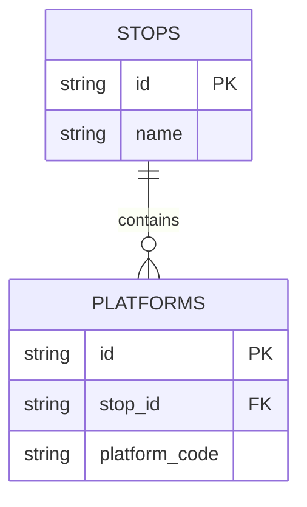
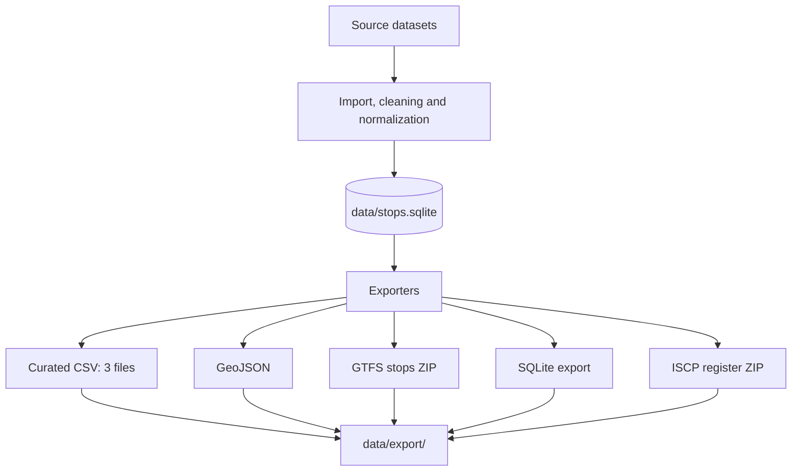

# Data exports

The [gtfs-sk/stops](https://github.com/gtfs-sk/stops) project produces a processed,
normalized dataset of public transport stops and platforms. This document describes
**what each exported file contains, how its columns are structured, and how to use it**.

All export files are generated in `data/export/` by running:

```bash
python build.py
```

> [!IMPORTANT]
> The main exports contain the **processed dataset**, not an unchanged copy of
> the ISCP source. The registry itself is published separately, as
> `iscp-register.zip` (see [ISCP register](#iscp-register-iscp-registerzip)).

## Available files

```text
data/
├── stops.sqlite                         # Working database (not an export)
└── export/
    ├── stops.csv                        # Stops only, curated columns
    ├── platforms.csv                    # Platforms only, curated columns
    ├── stops-and-platforms.csv          # Both, curated columns
    ├── stops.geojson                    # Geographic features
    ├── stops.gtfs.zip                   # ZIP containing stops.txt
    ├── stops.sqlite                     # Dedicated SQLite export
    └── iscp-register.zip                # Standalone ISCP registry (CSV/GeoJSON/SQLite)
```

| Format | File(s) | Contents | Recommended use |
| --- | --- | --- | --- |
| Curated CSV | `stops.csv`, `platforms.csv`, `stops-and-platforms.csv` | Stable, human-oriented schemas: **12 columns for stops**, **14 for platforms and combined** | Spreadsheets, analysis, integrations |
| GeoJSON | `stops.geojson` | Geographic features representing stops and platforms | GIS software, maps |
| GTFS | `stops.gtfs.zip` | A GTFS `stops.txt` table | GTFS-related tools and integrations |
| SQLite | `stops.sqlite` | A dedicated export database with an explicit schema: canonical stops/platforms, the ISCP registry tables and the match links | SQL queries and complete relational data access |
| ISCP register | `iscp-register.zip` | The ISCP registry on its own: `iscp-stops.csv`, `iscp-platforms.csv`, `iscp-stops.geojson`, `iscp.sqlite` | Working with the official registry without the processed dataset |

**Which file should I choose?** Use `stops.csv` when you want a list of stops,
`platforms.csv` when you want boarding locations, or `stops-and-platforms.csv`
when you want both as one table. Choose SQLite if you need **all database
tables and relationships** (it also carries the provenance columns
`original_name`, `source` and `source_id`). Choose `iscp-register.zip` when
you want the ISCP registry itself, without the processed dataset.

## Data model and identifiers

A **stop** represents a stop or station record. A **platform** is a separate
record associated with a stop. A stop can have zero or more platforms.



This diagram shows the relevant *logical relationship*, not the complete SQL
schema. The name of the foreign-key field depends on the export format:

| Context | Stop identifier | Platform identifier | Parent-stop reference |
| --- | --- | --- | --- |
| Curated CSV | `id` | `id` | `platform_parent_stop_id` |
| GeoJSON | `id` | `id` | `platform_parent_stop_id` |
| SQLite | `stops.id` | `platforms.id` | `platforms.platform_parent_stop_id` |
| GTFS `stops.txt` | `stop_id` | `stop_id` | `parent_station`, where applicable |

> [!NOTE]
> `platform_parent_stop_id` references the project's **internal `id` of the stop**;
> it is **not** an ISCP ID. `parent_station` is the standard GTFS field name
> and is not a replacement for `platform_parent_stop_id` in the CSV schema.

The three curated CSV files are different **views of the same records**, not
three independent datasets. Do not concatenate them and treat the result as
three distinct sets of stops or platforms.

## Curated CSV: fixed, record-specific schemas

**Files:** `stops.csv`, `platforms.csv`, `stops-and-platforms.csv`

The stop-only file omits the two platform-specific fields. The platform-only
and combined files retain both fields so platforms can be linked back to stops.
The first twelve columns use the same names and order in all three files.

**`stops.csv` — 12 columns:**

```csv
id,iscp_id,name,type,lat,lon,country,region,district,municipality,modes,amenities
```

**`platforms.csv` and `stops-and-platforms.csv` — 14 columns:**

```csv
id,iscp_id,name,type,lat,lon,country,region,district,municipality,modes,amenities,platform_code,platform_parent_stop_id
```

### Column reference

| Column | Data / representation | Description | Stops | Platforms |
| --- | --- | --- | --- | --- |
| `id` | Identifier (text) | Unique identifier of this stop or platform record. Use this for joins inside the dataset. | Stop ID | Platform ID |
| `iscp_id` | Source identifier (text, optional) | ISCP identifier of the matched registry record. It is distinct from `id`. Matches belong to stops, so platform rows leave this empty (read the parent stop's value instead). | Where matched | Empty |
| `name` | Text | Display name of the stop or platform. | Yes | Yes |
| `type` | Text | Record classification. Stop rows use the stop model's kind; platform rows use `platform`. | Stop kind | `platform` |
| `lat` | Decimal degrees, optional | Latitude of the record's geographic position. | Stop position | Platform position |
| `lon` | Decimal degrees, optional | Longitude of the record's geographic position. | Stop position | Platform position |
| `country` | Text, optional | Country associated with the record (for example, `SK`). | Where known | Where known |
| `region` | Text, optional | Administrative region. | Where known | Where known |
| `district` | Text, optional | Administrative district. | Where known | Where known |
| `municipality` | Text, optional | Municipality. | Where known | Where known |
| `modes` | Serialized multi-value field | Available transport modes, using the existing curated CSV serialization. | Stop modes | Platform modes |
| `amenities` | Serialized multi-value field | Amenities/accessibility attributes, using the existing curated CSV serialization. | Stop amenities | Platform amenities |
| `platform_code` | Text, optional | Platform number/code as represented by the source data. | Not included in `stops.csv`; empty for stop rows in the combined file | Where known |
| `platform_parent_stop_id` | Identifier (text), optional | ID of the stop to which the platform belongs; references a row in `stops.csv`. | Not included in `stops.csv`; empty for stop rows in the combined file | Parent stop ID |

The `modes` and `amenities` fields can contain multiple values. Their
representation is inherited from the existing `CsvExporter` implementation;
**do not assume they are separate CSV columns**. When importing, preserve the
complete cell value unless your application explicitly parses that format.

An empty CSV cell indicates no value was emitted for that field. It does not
necessarily mean the concept is absent (for example, an empty `amenities` cell
is not proof that a location has no amenities).

### Row selection

| File | Included rows | Excluded rows | Key relationship |
| --- | --- | --- | --- |
| `stops.csv` | One row per stop | All platform records | `id` is the stop ID; no platform-only columns |
| `platforms.csv` | One row per platform | All stop records | `platform_parent_stop_id` → `stops.csv.id` |
| `stops-and-platforms.csv` | Every stop **and** its platforms | Nothing from those two record types | `type` distinguishes rows; platform rows contain `platform_parent_stop_id` |

A stop without platforms still appears in `stops.csv` and
`stops-and-platforms.csv`; it does not create an artificial platform row.

For example, to associate each platform with its stop in Python:

```python
import csv

with open("data/export/stops.csv", encoding="utf-8", newline="") as f:
    stops = {row["id"]: row for row in csv.DictReader(f)}

with open("data/export/platforms.csv", encoding="utf-8", newline="") as f:
    for platform in csv.DictReader(f):
        stop = stops.get(platform["platform_parent_stop_id"])
        print(platform["name"], "→", stop["name"] if stop else "unknown stop")
```

## ISCP register: `iscp-register.zip`

The ISCP registry is a source dataset in its own right. It is loaded by
the ISCP crawler into dedicated database tables (`iscp_stops`,
`iscp_platforms`) and published unchanged -- as a normalized register,
not mixed with the processed OSM-based dataset -- in one ZIP asset:

| File inside the ZIP | Contents |
| --- | --- |
| `iscp-stops.csv` | One row per registry stop, including cancelled records |
| `iscp-platforms.csv` | One row per GPS coordinate pair of a registry stop |
| `iscp-stops.geojson` | One feature per coordinate pair (stops without GPS get a feature with `null` geometry) |
| `iscp.sqlite` | The two registry tables plus a `metadata` table; the `iscp_stops` table also carries the parsed source fields as JSON in `raw_fields` |

**`iscp-stops.csv` columns:**

```csv
iscp_id,municipality,local_part,locality,name_ids,name_mhd,display_name,district,country,transport_system,validity,is_cancelled,source_file
```

- The source name fields are kept separate (`name_ids`, `name_mhd`,
  `local_part`, `locality`); `display_name` is the derived registry name
  (`name_ids`, else `name_mhd`, else municipality + locality/local part).
- `is_cancelled` is `1` for cancelled registry records, else `0`.
  Cancelled records are part of the register export; they are only
  excluded from *matching* against canonical stops.
- `source_file` is the registry file (per municipality) the record was
  parsed from.

**`iscp-platforms.csv` columns:**

```csv
iscp_id,position,lat,lon
```

The registry does not name or number its platforms; `position` is the
order of the GPS coordinate pair in the source record.

The same two tables are also included in `stops.sqlite`, together with
the `iscp_matches` link table, so the register can be joined with the
canonical stops in one database.

## GTFS: `stops.gtfs.zip`

The ZIP archive contains exactly one table at the archive root:

```text
stops.gtfs.zip
└── stops.txt
```

The `stops.txt` file is UTF-8 CSV and uses these **eight GTFS header fields,
in this order**:

```csv
stop_id,stop_name,stop_lat,stop_lon,location_type,parent_station,platform_code,wheelchair_boarding
```

| GTFS field | Values / representation | How this exporter populates it |
| --- | --- | --- |
| `stop_id` | Text identifier | ID of the exported stop, station or platform record. |
| `stop_name` | Text | Name of that record. |
| `stop_lat` | Decimal degrees | Record latitude. |
| `stop_lon` | Decimal degrees | Record longitude. |
| `location_type` | `0` or `1` | `1` for station records; `0` for ordinary stops and platform records. |
| `parent_station` | GTFS `stop_id`, optional | Parent stop ID **only if** the parent is represented as a station (`location_type=1`). Otherwise empty. |
| `platform_code` | Text, optional | Platform code for platform records; otherwise empty. |
| `wheelchair_boarding` | `0` or `1` | `1` if the wheelchair amenity is explicitly present, otherwise `0` (no information). The exporter does not emit `2`. |

**GTFS row behavior:** station records are emitted with
`location_type=1`; their platforms are emitted with `location_type=0` and
`parent_station` set to the station ID. A non-station stop **without** platforms
is emitted as a `location_type=0` record. If a non-station stop **has** platform
records, the exporter emits its platforms as unparented `location_type=0`
records rather than emitting a separate parent station record. As a result,
this file is **not a one-to-one copy** of `stops-and-platforms.csv`.

> [!WARNING]
> This ZIP is **not a complete GTFS Schedule feed**. It does not include
> `agency.txt`, `routes.txt`, `trips.txt`, `stop_times.txt` or other required
> feed tables. Some GTFS validators or consumers require a complete feed.
> See the [GTFS Schedule `stops.txt` reference](https://gtfs.org/documentation/schedule/reference/#stopstxt).

## GeoJSON: `stops.geojson`

The GeoJSON export represents stop and platform records as geographic features.
Its top-level structure is a **GeoJSON `FeatureCollection`**:

```json
{
  "type": "FeatureCollection",
  "features": [
    {
      "type": "Feature",
      "geometry": { "type": "Point", "coordinates": [18.0, 48.0] },
      "properties": {}
    }
  ]
}
```

The example above illustrates GeoJSON structure, **not an actual exported
record or a guaranteed list of properties**. GeoJSON coordinates are written
as **`[longitude, latitude]`**, unlike the `lat`, `lon` ordering in CSV.

The exact contents of each feature's `properties` object are defined by the
project's `GeoJsonExporter`, not by the curated/full CSV column lists.

To inspect the property keys of the generated file:

```python
import json

with open("data/export/stops.geojson", encoding="utf-8") as f:
    collection = json.load(f)

print(collection["type"])
print(sorted({key for feature in collection["features"]
              for key in feature.get("properties", {})}))
```

For a complete attribute reference, use the CSV or SQLite exports alongside
GeoJSON.

## SQLite: `stops.sqlite`

`data/export/stops.sqlite` is a **dedicated export database**: it is built
from scratch with the explicit schema below. It is *not* a backup of the
working database at `data/stops.sqlite` -- the working database's layout
is an implementation detail (its platform foreign key is called
`stop_id`; the export calls it `platform_parent_stop_id`, like every
other public export).

### Tables and views

| Table / view | Purpose | Key fields / relationships |
| --- | --- | --- |
| `stops` | Stop/station records | `id` (primary key), `iscp_id`, `name`, `type` (`stop`/`station`), coordinates, administrative location, `modes`/`amenities` (JSON arrays), provenance (`original_name`, `source`, `source_id`) |
| `platforms` | Platform records | `id` (primary key), `platform_parent_stop_id` (reference to `stops.id`), `platform_code`, coordinates, provenance |
| `iscp_stops`, `iscp_platforms` | The ISCP registry | Same schema as the standalone register export (see above) |
| `iscp_matches` | Links between canonical stops and registry records | `stop_id` (primary key), `iscp_id`, `quality` (`exact`/`high`/`medium`), `distance_m` |
| `metadata` | Export metadata | `schema_version`, `dataset`, `generated_at` |
| `stops_and_platforms` (view) | Stops and platforms as one table | Same columns as `stops-and-platforms.csv` |

Platforms do not carry their own `iscp_id`: a match belongs to the stop.
Join a platform to `stops` (via `platform_parent_stop_id`) to read it.

### Useful SQL queries

```sql
-- List actual tables and views.
SELECT type, name
FROM sqlite_schema
WHERE type IN ('table', 'view') AND name NOT LIKE 'sqlite_%'
ORDER BY type, name;

-- Inspect the exact schema of a table.
PRAGMA table_info('stops');
PRAGMA table_info('platforms');
PRAGMA foreign_key_list('platforms');

-- Join platforms to their parent stops.
SELECT p.id AS platform_id, p.name AS platform_name,
       s.id AS stop_id, s.name AS stop_name
FROM platforms AS p
LEFT JOIN stops AS s ON p.platform_parent_stop_id = s.id
LIMIT 20;
```

You can open the file directly using SQLite-compatible tools, for example:

```bash
sqlite3 data/export/stops.sqlite
```

**`data/stops.sqlite` vs `data/export/stops.sqlite`:** the former is the
working database produced by the pipeline (internal layout); the latter
is the export database intended for distribution. If you want to download
the dataset, choose the file inside `data/export/`.

## Generation and publication



1. Run `python build.py` to rebuild the working dataset and generate the export
   files in `data/export/`.
2. Each export can be distributed or downloaded separately. Users do not need
   the project source code to read an already generated CSV, GeoJSON, ZIP or
   SQLite file.
3. Publication to a remote location (for example, **GitHub Releases** or a
   static download host) requires a separate publishing workflow. Its URL,
   release cadence and retention policy are **not defined by the exporter**.

### Encoding and compatibility

- CSV and GTFS `stops.txt` use **UTF-8**, comma-separated fields and a header
  row. Values containing commas or quotes are escaped by Python's CSV writer.
- Curated CSVs use fixed, documented schemas: **12 columns** in `stops.csv`
  and **14 columns** in `platforms.csv` and `stops-and-platforms.csv`. The
  SQLite export schema is versioned in its `metadata` table
  (`schema_version`).
- A blank value can mean **unknown**, **not provided** or **not applicable**, as
  described above. It should not automatically be interpreted as a negative.
- The build generates fresh outputs rather than a history of previous
  versions. Historical snapshots require an external release/archive process.
- Dataset completeness, geographic accuracy and freshness depend on the
  available source data and the processing pipeline; no real-time updates or
  complete national coverage are implied by the file formats themselves.

### Naming changes from older versions

| Previous name / meaning | Current name / meaning |
| --- | --- |
| `stops.csv` containing both stops and platforms | `stops-and-platforms.csv` |
| `parent_stop_id` in curated CSV | `platform_parent_stop_id` |
| `platforms.stop_id` in the SQLite export | `platforms.platform_parent_stop_id` |
| `parent_stop_id` in GeoJSON | `platform_parent_stop_id` |
| `stops.full.csv`, `platforms.full.csv`, `stops-and-platforms.full.csv` | **removed** -- the full model dumps were not a stable public schema; provenance columns live in the SQLite export |

In the current layout, `stops.csv` means **stops only**;
`stops-and-platforms.csv` means **both record types**. The names
`stops.geojson`, `stops.gtfs.zip` and `stops.sqlite` are established format
names and do not imply the same row filter as `stops.csv`.
